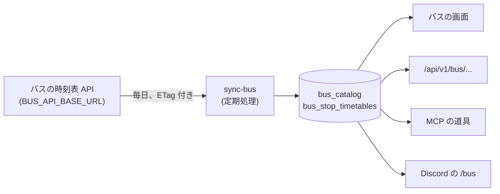

# 16. バス時刻表

函館バスの時刻表を、「バス」の画面、公開 API、MCP、Discord の `/bus` で見られます。バスの機能は、環境変数 `BUS_API_BASE_URL` を書いたサーバーだけで有効になります。書かなければ、メニューにも API にも出ません。

## 16.1 別の時刻表 API から取り込む

Funmary は、事業者のデータを自分では取りに行きません。「停留所ごとの発車表」を返す小さな API (契約は公開リポジトリ [hakobus-types](https://github.com/funmary-app/hakobus-types) の OpenAPI) から取り込みます。この API の実装は Funmary の外にあり、返すデータの権利は、実装する側が責任を持ちます。

- 契約は「停留所の一覧」と「停留所と版を指定した発車表」だけです。便をまたいで停留所をたどる情報 (GTFS の `stop_times` のようなもの) は持ちません
- 時刻表は「ダイヤの版」ごとに変わります。API は、改正の前から次の版を返せます。Funmary は、一覧にあるすべての版の発車表を保存し、日付に有効な版 (有効になる日が、その日以前のうち最も新しいもの) で答えます
- 発車表は、のりばと、平日 (`weekday`) か土曜、日曜、祝日 (`holiday`) の区分ごとに分かれています。祝日は、時間割と同じ祝日の表を使って決めます
- 24 時以降の発車 (`24:10` など) は、日付が変わったあとも前日のダイヤで数えます。金曜の深夜便は、土曜になっても平日のダイヤです

## 16.2 取り込み

定期処理 `sync-bus` が、毎日、日本時間の 5 時 30 分に動きます。ほかの取得元と同じく、取得元の見張り (名前は `bus`) で失敗を数え、続けて失敗したら試す間隔を広げて、管理用の通知で知らせます。`SOURCES_DISABLED` に `bus` を書くと止められます。

- 停留所の一覧と、一覧にある版 × 停留所の発車表を、前回の `ETag` を付けて取ります。変わっていなければ (304)、確かめた日時だけを更新します
- 取れなかった発車表があっても、取れた分は保存します。最後に、失敗として記録して知らせます
- API が「その版か停留所がない」(404) を返した発車表は、失敗にせず数えるだけです
- 一覧にない版と停留所の発車表は、取り込みのたびに捨てます
- 応答が契約の形と違ったときは (`schemaVersion` が 2 でない、時刻が `HH:MM` でないなど)、失敗として扱い、保存した内容は入れ替えません

保存するのは `bus_catalog` (一覧。行は 1 つ) と `bus_stop_timetables` (停留所と版ごとの発車表) です。どちらも、検査を通った JSON と `ETag`、API に最後に確かめた日時を持ちます。

## 16.3 画面

メニューの「設定」の 1 つ手前に「バス」を出します。

- 既定は、強調する停留所 (はこだて未来大学と、亀田支所前) の「次のバス」です。発車の時刻、あと何分か、系統、経由と行き先、のりばを出します。1 分ごとに読み直します
- 停留所を選ぶと、その停留所の次のバスと、のりばごとの時刻表 (時の行に、分と系統を並べる) を出します。平日と、土曜、日曜、祝日を切り替えられ、今日の区分には「(今日)」を付けます。事業者の注意書き (印の意味) は、時刻表の下に出します
- 時刻表を最後に確かめてから 3 日以上たったときは、古いかもしれないと表示します
- 取り込む前は、まだ取り込めていないことを案内します
- 遅れや現在位置は出しません。時刻表の API が返すのは、決まった時刻表だけです

強調する停留所は、今は固定です (`DEFAULT_BUS_STOP_IDS`)。利用者が自分の停留所を決める設定は、予定です。

## 16.4 API、MCP、Discord

同じ読み取りの関数 (`packages/api/src/reads/bus.ts`) を、画面と各口が呼びます。範囲は `read:transit` です。バスの機能を使わないサーバーでは、API は 404 を返し、MCP の道具は出ません。

| 口                               | 内容                                                                  |
| -------------------------------- | --------------------------------------------------------------------- |
| `GET /api/v1/bus/stops`          | 停留所と版の一覧。強調する停留所には `highlighted` が付く             |
| `GET /api/v1/bus/stops/{stopId}` | 停留所の発車表。`generation` を省くと、今日に有効な版                 |
| `GET /api/v1/bus/next`           | 今から先の発車。`stopId` を省くと強調する停留所。`limit` は 1 から 20 |
| MCP `list_bus_stops` ほか 2 つ   | `get_bus_stop_timetable`、`get_next_buses`。REST と同じ中身           |
| Discord `/bus`                   | 強調する停留所の次のバスを、本人にだけ見せる                          |

## 16.5 予定

- 利用者が自分の停留所を決める設定
- 遅れと現在位置 (時刻表の API の契約に、その情報が入ってから)
